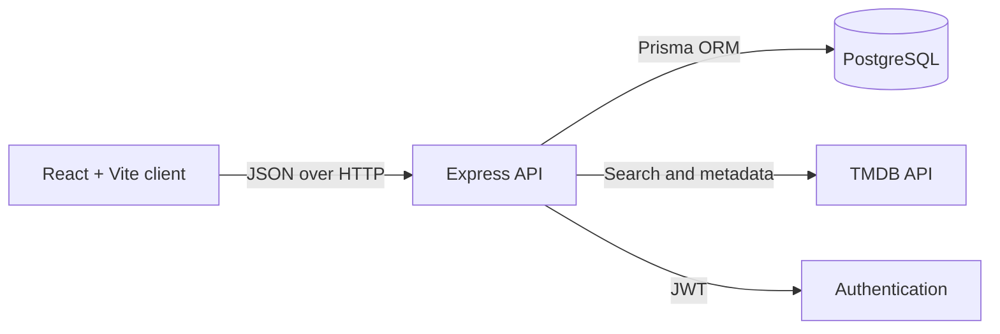
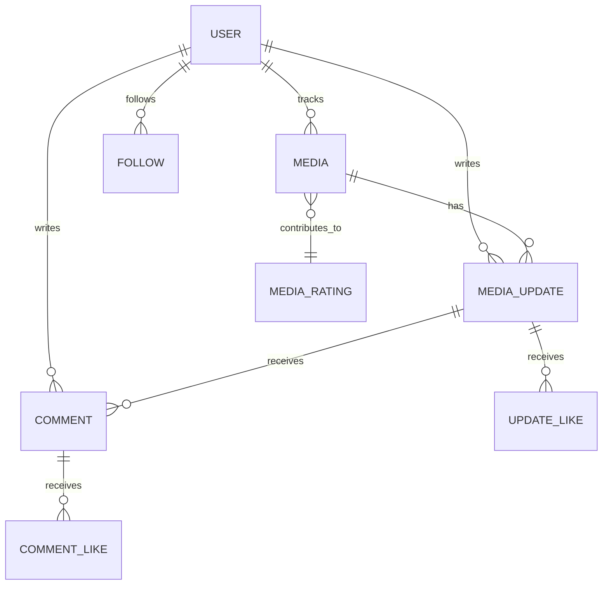

# Watchly

<p align="center">
  <strong>A social home for what you watch.</strong><br />
  Discover films and series, keep a living watchlist, share progress, and find your people.
</p>

<p align="center">
  <a href="#quick-start">Quick start</a>
  ·
  <a href="#features">Features</a>
  ·
  <a href="#architecture">Architecture</a>
  ·
  <a href="#api-at-a-glance">API</a>
</p>

<p align="center">
  
  
  
  
  
</p>

> [!NOTE]
> Watchly uses [The Movie Database (TMDB)](https://www.themoviedb.org/) for film and television metadata. TMDB credentials are required for search, detail pages, and seed data.

## What it does

Watchly combines a personal media tracker with a social feed. Add a title to a watchlist, log a session and rating, then see the conversation unfold around it.

| Discover | Track | Connect |
| :--- | :--- | :--- |
| Search films and series through TMDB | Organize titles by viewing status | Follow people and browse their activity |
| See title details, artwork, and aggregate ratings | Log watch sessions with notes and a 1 to 5 rating | Like and comment on updates |
| Browse trending media | Maintain a personal weighted rating | Explore profiles, stats, and watchlists |

## Features

- **Account access** with registration, login, JWT authentication, and protected routes.
- **Media discovery** powered by TMDB search, trending results, and rich title details.
- **Watchlists** for Currently Watching, Want to Watch, Hiatus, Watched, and Dropped titles.
- **Session updates** with what was watched, a note, a rating, and a short, medium, or long session length.
- **Weighted ratings** that turn each person's session ratings into a personal title rating and surface a sitewide average.
- **Social layer** with feeds, follow relationships, comments, and likes on both updates and comments.
- **Profiles** with editable bios, activity stats, watchlist accordions, and follower information.

## Architecture



| Layer | Responsibility | Main tools |
| :--- | :--- | :--- |
| `frontend/` | Responsive single-page experience and authentication state | React, React Router, Vite, TypeScript |
| `backend/` | REST API, authorization, business rules, TMDB integration | Express, Prisma, JWT, bcrypt |
| `backend/prisma/` | PostgreSQL schema, migrations, and demo seed | Prisma, PostgreSQL |
| `docker-compose.yml` | Development environment for all three services | Docker Compose |

## Quick start

### Prerequisites

- [Docker Desktop](https://www.docker.com/products/docker-desktop/)
- A [TMDB API key](https://developer.themoviedb.org/docs/getting-started)

### 1. Configure the environment

Create a `.env` file at the repository root.

```dotenv
POSTGRES_USER=watchly
POSTGRES_PASSWORD=watchly_password
POSTGRES_DB=watchly
JWT_SECRET=replace-with-a-long-random-secret
TMDB_API_KEY=your_tmdb_api_key

# Optional local port overrides
# BACKEND_PORT=4000
# FRONTEND_PORT=5173
```

> [!TIP]
> Keep `.env` private. It is already ignored by Git, which is exactly where secrets belong.

### 2. Start Watchly

```bash
docker compose up --build
```

When the services are ready, open <http://localhost:5173>. The API health check is available at <http://localhost:4000/health>.

### 3. Load demo data

In a second terminal, run:

```bash
docker compose exec backend npm run db:migrate
docker compose exec backend npm run db:seed
```

The seed creates four sample accounts and a social graph. Each uses the password `password123`.

<details>
<summary><strong>Prefer running services without Docker?</strong></summary>

Run PostgreSQL locally, configure `DATABASE_URL` in `backend/.env`, then install and start each app in separate terminals.

```bash
# Terminal 1
cd backend
npm install
npm run db:migrate
npm run dev

# Terminal 2
cd frontend
npm install
npm run dev
```

For this route, the backend requires `DATABASE_URL`, `JWT_SECRET`, and `TMDB_API_KEY`. The frontend optionally accepts `VITE_API_URL`, which defaults to `http://localhost:4000`.

</details>

## Everyday commands

| Goal | Command |
| :--- | :--- |
| Start the full stack | `docker compose up --build` |
| Stop containers | `docker compose down` |
| Run database migrations | `docker compose exec backend npm run db:migrate` |
| Seed the database | `docker compose exec backend npm run db:seed` |
| Open Prisma Studio | `docker compose exec backend npm run db:studio` |
| Build the frontend | `cd frontend && npm run build` |
| Build the backend | `cd backend && npm run build` |

## API at a glance

The API listens on port `4000` by default. Authenticated endpoints expect:

```http
Authorization: Bearer <token>
```

| Area | Selected endpoints |
| :--- | :--- |
| Health | `GET /health` |
| Authentication | `POST /auth/register`, `POST /auth/login`, `GET /auth/me` |
| TMDB | `GET /tmdb/search`, `GET /tmdb/trending`, `GET /tmdb/:type/:tmdbId` |
| Media library | `GET /media`, `POST /media`, `PUT /media/:mediaId/watchlist`, `DELETE /media/:mediaId` |
| Ratings | `GET /ratings/:tmdbId` |
| Updates | `GET /updates`, `POST /updates`, `PUT /updates/:updateId`, `DELETE /updates/:updateId` |
| Social | `POST /updates/:updateId/like`, `POST /updates/:updateId/comments`, `POST /users/:userId/follow` |
| Users | `GET /users/search`, `GET /users/:userId`, `GET /users/:userId/watchlists` |

<details>
<summary><strong>How ratings work</strong></summary>

Each update has a 1 to 5 rating and a session length. Session length determines its weight:

| Session | Weight |
| :--- | ---: |
| Short | 1 |
| Medium | 2 |
| Long | 3 |

The personal rating is the weighted average of that person's updates for the title. Sitewide ratings then average the available personal ratings.

</details>

## Data model



## Project layout

```text
watchly/
├── frontend/                 # React application
│   └── src/
│       ├── components/       # Reusable UI building blocks
│       ├── contexts/         # Authentication state
│       ├── pages/            # Route-level views
│       └── lib/              # API client, types, and formatters
├── backend/                  # Express application
│   ├── prisma/               # Schema, migrations, and seed script
│   └── src/
│       ├── controllers/      # HTTP request handling
│       ├── services/         # Domain and integration logic
│       ├── middleware/       # JWT helpers
│       └── routes/           # REST route definitions
└── docker-compose.yml        # Local development stack
```

## Development checklist

- [x] TypeScript on both client and server
- [x] PostgreSQL schema and migration history
- [x] Dockerized development services
- [x] Seed script for a populated local experience
- [x] Health endpoint for service checks
- [ ] Automated test suite

## Credits

This product uses the TMDB API but is not endorsed or certified by TMDB.

---

<p align="center">Built for people who always have one more episode in them.</p>
